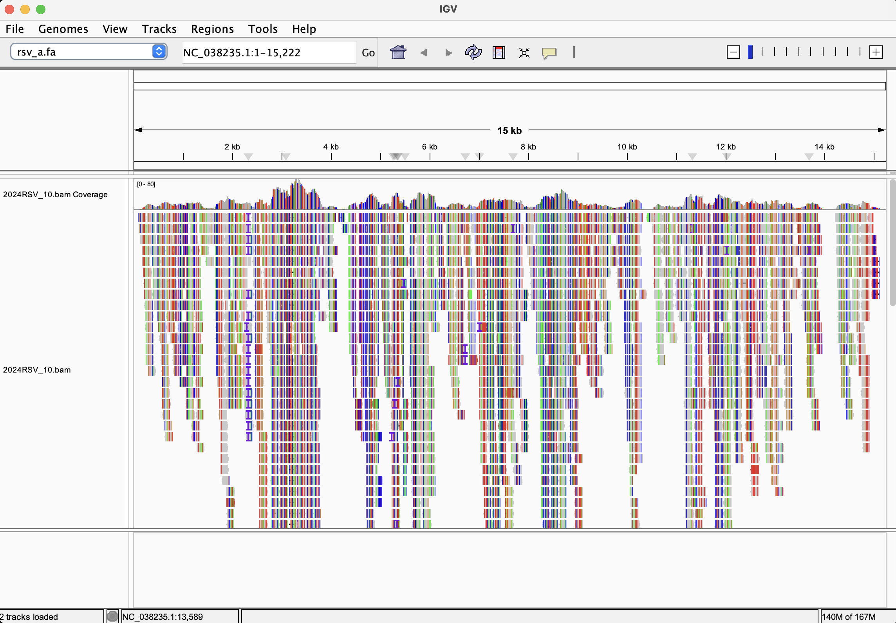

# Week 05 - Generate a BAM file

I aligned a subset of the Illumina reads from [week04](../week04/) to the RSV
subgroup A reference genome from [week02](../week02/) and made a sorted,
indexed BAM file.

| | |
|---|---|
| Reference genome | RSV-A, RefSeq NC_038235.1 (assembly GCF_002815475.1), 15,222 bp |
| Sequencing run | [SRR35979456](https://www.ncbi.nlm.nih.gov/sra/SRR35979456), Illumina MiSeq, WGS, paired-end 2×151 bp |
| Sample | 2024RSV_10 (RSV-A, University of New South Wales, 2024) |
| Reads used (`N`) | first 1,000 read pairs (of 181,607) |
| Output | `bam/2024RSV_10.bam` (+ `.bai`) |

## How to reproduce

Requirements (in the `bioinfo` environment, plus `fastq-dump` from
sra-tools): `make`, `curl`, `fastq-dump`, `seqkit`, `bwa`, `samtools`.

```bash
micromamba activate bioinfo

make estimate     # compute N for 10x coverage
make              # genome -> fastq -> index -> align -> stats
```

Individual steps and helpers:

```bash
make genome       # download the reference FASTA (and samtools faidx it)
make fastq        # download the first N read pairs from SRA
make index        # bwa index the genome
make align        # bwa mem | samtools sort, then samtools index
make stats        # samtools flagstat + coverage, % of bases >= 10x
make N=2000       # use more reads (run 'make clean' first)
make clean        # remove reads and BAM
make realclean    # also remove the genome and index
```

All variables (URL, SRR, N, sample name, file names) are defined at the top
of the [Makefile](Makefile), so another paired-end run can be aligned with
e.g. `make SRR=... SAMPLE_NAME=...`.

Files are placed in directories named after the data type:

```
week05/
├── Makefile
├── README.md
├── images/   # IGV screenshot
├── fasta/    # rsv_a.fa + .fai and bwa index files
├── fastq/    # SRR35979456_1.fastq, SRR35979456_2.fastq
└── bam/      # 2024RSV_10.bam, 2024RSV_10.bam.bai
```

The BAM file has a read group (`SM:2024RSV_10`) so the sample name shows up
in IGV.

## How I chose N

Coverage = (number of reads × read length) / genome size. With paired-end
reads each pair (spot) gives 2 × 151 = 302 bp, so:

```
N = coverage × genome size / (2 × read length)
  = 10 × 15,222 / 302
  ≈ 505 read pairs
```

`make estimate` does this calculation with the genome size from the FASTA
and the read length from the SRA metadata.

505 pairs is only the **average** needed for 10x, and it assumes every read
aligns. The coverage of this library is not uniform (see below), so with
~505 pairs only ~39% of the genome reached 10x (I tested by subsampling the
BAM with `samtools view -s`). I doubled it to **N = 1,000 pairs**, which gives
a mean depth of 18x. This is still tiny and runs in seconds on a laptop.
The whole run (181,607 pairs) would be ~3,600x.

## Results

### What percent of the reads align?

`samtools flagstat`:

```
2000 + 0 in total (QC-passed reads + QC-failed reads)
1962 + 0 mapped (98.10% : N/A)
2000 + 0 paired in sequencing
1948 + 0 properly paired (97.40% : N/A)
8 + 0 singletons (0.40% : N/A)
```

**98.1% of the reads align** and 97.4% are properly paired. So almost all of
the reads are RSV-A, with very little host (human) contamination. (With all
10,000 pairs from week04 the numbers are nearly the same: 97.7% mapped.)

`samtools coverage`:

```
#rname       startpos endpos numreads covbases coverage meandepth meanbaseq meanmapq
NC_038235.1  1        15222  1962     14687    96.49    18.33     37.4      59.6
```

96.5% of the genome is covered by at least one read, and **74.1% of the bases
have ≥ 10x**. The mean insert size is 301 bp.

### Is the coverage uniform?

**No.** Mean depth per 1 kb window (`samtools depth -a`):

| Window (kb) | 0–1 | 1–2 | 2–3 | 3–4 | 4–5 | 5–6 | 6–7 | 7–8 |
|---|---:|---:|---:|---:|---:|---:|---:|---:|
| Mean depth | 10.7 | 14.8 | 22.8 | **41.7** | 15.3 | 24.4 | 13.5 | 21.3 |

| Window (kb) | 8–9 | 9–10 | 10–11 | 11–12 | 12–13 | 13–14 | 14–15 | 15–15.2 |
|---|---:|---:|---:|---:|---:|---:|---:|---:|
| Mean depth | 27.0 | 11.0 | 11.4 | 23.4 | 19.1 | 11.9 | 10.3 | **2.1** |

Depth varies about 4-fold between regions, in waves of a few kb. The SRA
metadata says the library selection was **PCR**, so the genome was probably
amplified in several overlapping PCR fragments before library prep, and some
fragments were amplified more than others. Bases with **zero** coverage:

- **1–109** and **15,107–15,222**: the two ends of the genome (leader and
  trailer). PCR primers cannot sit outside the amplified region, so the ends
  are not covered.
- **13,971–14,208** (238 bp, inside the L gene) and a few short gaps of
  3–33 bp (e.g. 4,137–4,151, 5,573–5,605). These are only **sampling gaps**
  from using so few reads: when I aligned the 10,000 pairs from week04, the
  L-gene gap had a mean depth of 54x.

The uneven pattern itself is real. It is the same with 10,000 pairs (mean
depth per kb from 94x to 408x, highest again at 3–4 kb), so it comes from the
library and not from the small subset.

### What do the alignments look like? Errors or variations?

The reads differ from the reference much more than sequencing errors could
explain. `samtools stats` reports **16,072 mismatches in 279,113 aligned bases
(5.8%)**, but the reads are high quality (mean base quality Q37, i.e. ~0.02%
errors). Calling variants with
`bcftools mpileup | bcftools call -mv --ploidy 1` gives **812 SNPs** and 1
indel (an extra `G` at 2,326, at the end of the N gene). Transitions
outnumber transversions 4 to 1 (ts/tv = 4.0), which is typical of real
virus evolution and not of random errors.

In IGV the same mismatches appear in **every** read at a position (a full
colored column), not scattered in single reads. These are real differences
between this 2024 clinical virus and the much older RSV-A reference, so
roughly 1 in 19 bases has changed. Sequencing errors show up differently: as
an isolated mismatch in a single read.

One region stands out: near the end of the **G gene** (attachment
glycoprotein), coverage drops from ~27x to ~11x exactly at position 5,491,
and many reads are soft-clipped at that point (e.g. CIGAR `68M83S`,
`72M78S`). G is the most variable RSV gene. Current RSV-A viruses (ON1-like
lineages) carry a 72-nt duplication in this part of G that older references
do not have, which would explain reads that cannot be aligned across this
spot. I did not confirm this, but it would be the next thing to check.

### IGV

I loaded `fasta/rsv_a.fa` as the genome (Genomes → Load Genome from File) and
`bam/2024RSV_10.bam` as a track (File → Load from File).



The whole genome at once (`NC_038235.1:1-15,222`). The coverage track shows
the uneven depth (the peak at ~3–4 kb) and the empty genome ends. The reads
are covered in colored vertical stripes. Each stripe is a position where
nearly every read disagrees with the reference, so these are the ~800 real
variants, not random errors. The column of purple `I` marks near 2.3 kb is
the 1-bp insertion at position 2,326 that bcftools called.

## Summary

- 1,000 read pairs (~2× the theoretical 505 for 10x) gave a mean depth of 18x
  with ≥ 10x over 74% of the genome.
- 98% of reads align, so the sample is almost pure RSV-A.
- Coverage is uneven (PCR amplification): ~4-fold variation, with uncovered
  uncovered genome ends. Small gaps inside the genome fill in with more
  reads.
- The sample differs from the reference at ~800 positions (~5%); these are
  real variants, not errors.
