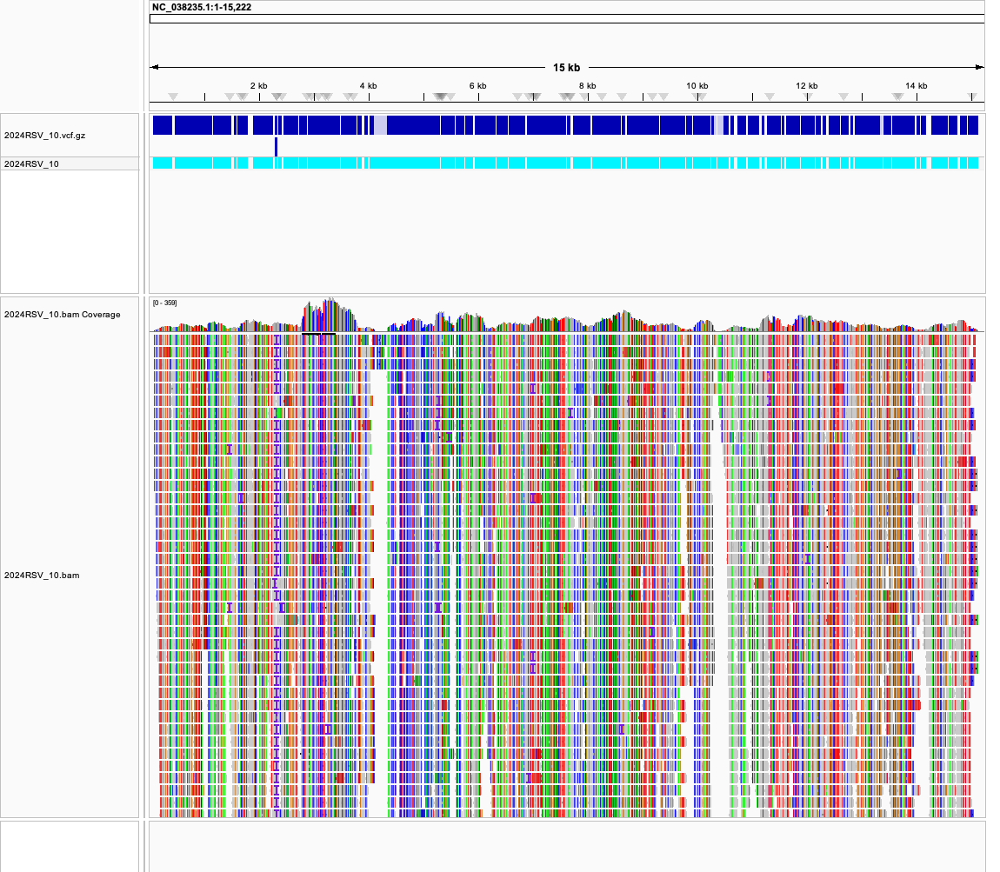
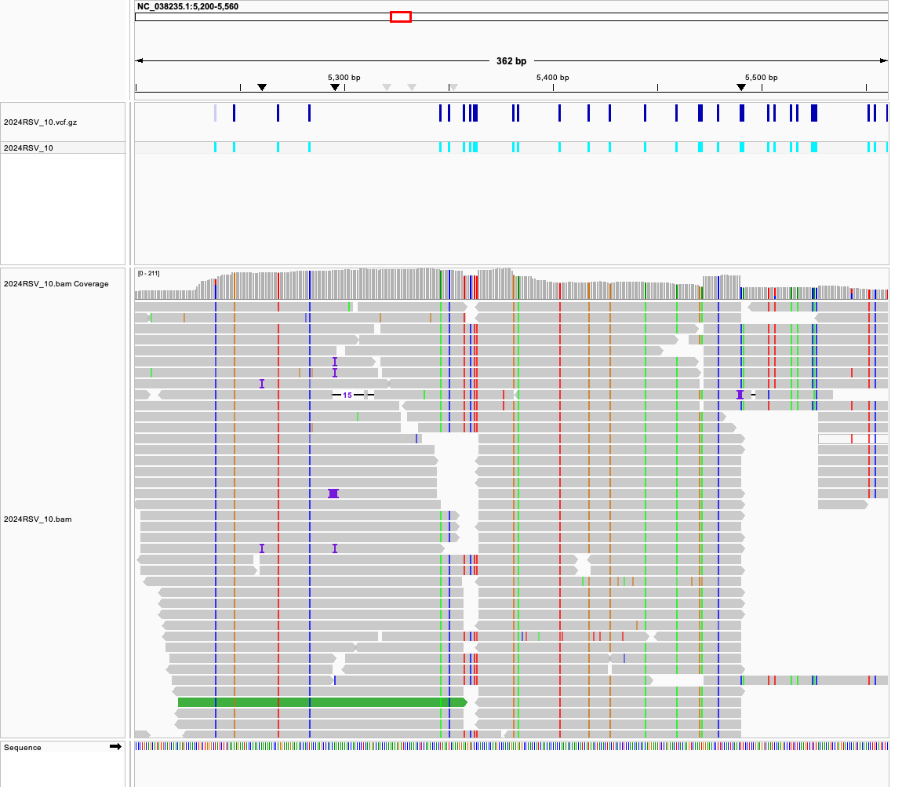
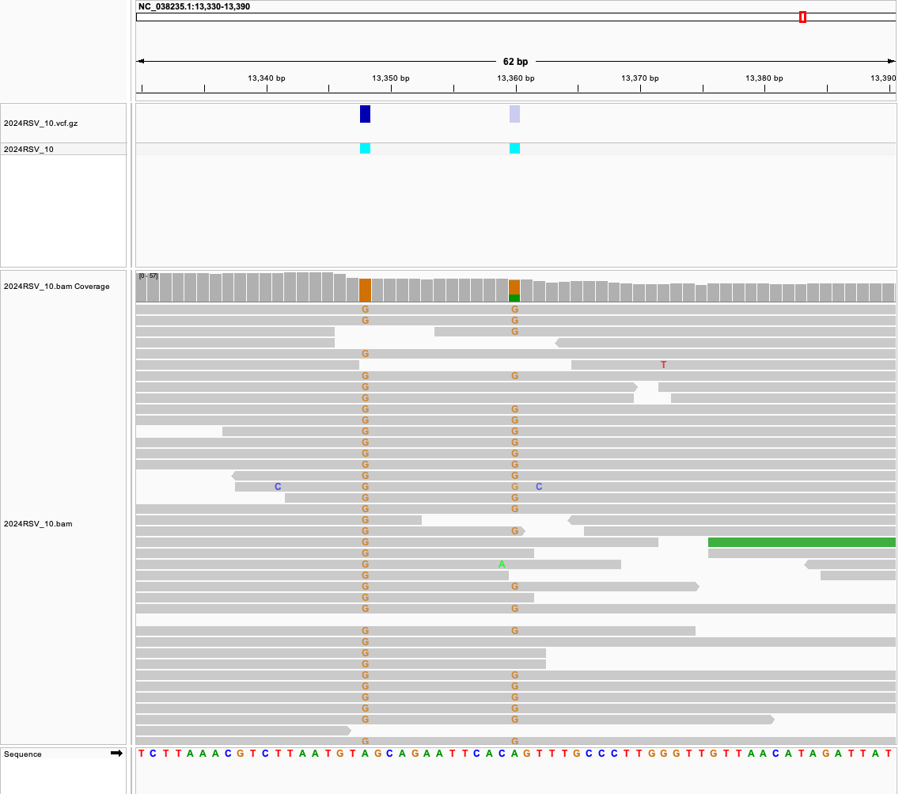

# Week 07 - Generate a VCF file

I extended the [week05](../week05/) pipeline (reads → BAM) with a variant
calling step (BAM → VCF) using `bcftools`, ran `bcftools stats` on the
result, and checked the calls in IGV.

| | |
|---|---|
| Reference genome | RSV-A, RefSeq NC_038235.1 (assembly GCF_002815475.1), 15,222 bp |
| Sequencing run | [SRR35979456](https://www.ncbi.nlm.nih.gov/sra/SRR35979456), Illumina MiSeq, WGS, paired-end 2×151 bp |
| Sample | 2024RSV_10 (RSV-A, University of New South Wales, 2024) |
| Reads used (`N`) | first 5,000 read pairs (of 181,607) |
| Outputs | `bam/2024RSV_10.bam`, `vcf/2024RSV_10.vcf.gz` (+ `.csi`), `vcf/2024RSV_10.stats.txt` |

## How to reproduce

Requirements (in the `bioinfo` environment, plus `fastq-dump` from
sra-tools): `make`, `curl`, `fastq-dump`, `seqkit`, `bwa`, `samtools`,
`bcftools`.

```bash
micromamba activate bioinfo

make              # genome -> fastq -> index -> align -> stats -> vcf -> vcfstats
```

Individual steps and helpers:

```bash
make genome       # download the reference FASTA (and samtools faidx it)
make fastq        # download the first N read pairs from SRA
make index        # bwa index the genome
make align        # bwa mem | samtools sort, then samtools index
make stats        # samtools flagstat + coverage, % of bases >= 10x
make vcf          # bcftools mpileup | call | norm | filter | sort
make vcfstats     # bcftools stats on the VCF (saved to vcf/*.stats.txt)
make estimate     # theoretical N for 10x coverage
make N=10000      # use more reads (run 'make clean' first)
make clean        # remove reads, BAM and VCF
make realclean    # also remove the genome and index
```

All variables (URL, SRR, N, sample name, file names, and the `ANN`, `CALL`
and `FILTER` parameters) are defined at the top of the [Makefile](Makefile),
so another paired-end run can be processed with e.g.
`make SRR=... SAMPLE_NAME=...`.

```
week07/
├── Makefile
├── README.md
├── images/   # IGV screenshots
├── fasta/    # rsv_a.fa + .fai and bwa index files
├── fastq/    # SRR35979456_1.fastq, SRR35979456_2.fastq
├── bam/      # 2024RSV_10.bam, 2024RSV_10.bam.bai
└── vcf/      # 2024RSV_10.vcf.gz, .csi index, stats report
```

## Step 1: at least 10x coverage

In week05 I used 1,000 read pairs, which gave a mean depth of 18x but only
**74%** of the genome at ≥ 10x, because coverage is uneven (PCR amplicons).
For variant calling I raised it to **N = 5,000 pairs**:

```
#rname       startpos endpos numreads covbases coverage meandepth meanbaseq meanmapq
NC_038235.1  1        15222  9785     14979    98.40    91.33     37.6      59.5
Bases covered >= 10x:
  14576 of 15222 (95.8%)
```

97.7% of the reads map, mean depth is **91x**, and **95.8%** of the genome
has ≥ 10x. The bases that are still below 10x:

| Region | Length | Where | Why |
|---|---:|---|---|
| 1–108, 15,114–15,222 | 108, 109 | genome ends (leader / trailer) | outside the PCR amplicons, never covered |
| 4,122–4,351 | 230 | end of M, start of SH | depth drops from ~30x to 1–5x; probably an amplicon junction or primer site that amplified poorly |
| 10,322–10,472 | 151 | inside L | same kind of dip |
| a few 1–33 bp spots | | e.g. 5,573–5,605 | short dips |

The ends cannot be fixed with more reads. The internal dips are where the
filter below marks calls as low-depth.

## Step 2: calling variants

The `vcf` target follows the bcftools pipeline from the lecture:

```make
ANN    = -d 1000 --annotate 'INFO/AD,FORMAT/DP,FORMAT/AD,FORMAT/ADF,FORMAT/ADR,FORMAT/SP'
CALL   = --ploidy 1 --annotate 'FORMAT/GQ'
FILTER = QUAL<30 || INFO/DP<10

bcftools mpileup $(ANN) -O u -f $(GENOME_FASTA) $(BAM) \
    | bcftools call $(CALL) -mv -O u \
    | bcftools norm -f $(GENOME_FASTA) -d all -O u \
    | bcftools filter -s LowQual -e '$(FILTER)' -O u \
    | bcftools sort --write-index -O z -o $(VCF)
```

What each step and parameter does, and what I changed from the lecture
example:

- **`mpileup`** computes genotype likelihoods at every position from the
  reads and the reference.
  - `-d 1000`: maximum reads per position. The default is 250 and the
    lecture uses 100, but some regions here reach ~360x, so a low cap would
    throw reads away for no reason. (On a 15 kb genome this costs nothing.)
  - `--annotate`: adds the allele depth (`AD`), per-strand allele depths
    (`ADF` forward, `ADR` reverse), total depth (`DP`) and a strand-bias
    score (`SP`). I used these below to decide which calls are real.
- **`call -mv`**: `-m` is the multiallelic caller, `-v` outputs variant sites
  only.
  - `--ploidy 1`: **changed from 2.** RSV is an RNA virus with one genome copy
    per particle, so a "heterozygous" genotype makes no sense. With ploidy 2
    the caller could report `0/1` calls that look like heterozygotes but are
    really a mixture of viruses or errors.
  - `--annotate FORMAT/GQ`: genotype quality.
- **`norm -f ... -d all`**: left-aligns and normalizes indels against the
  reference and removes duplicate records, so the same variant is always
  written the same way.
- **`filter -s LowQual -e '...'`**: **added.** Following the lecture
  ("maximize sensitivity first, then filter"), I keep **every** call but set
  the `FILTER` column to `LowQual` when `QUAL < 30` (less than 99.9% sure) or
  depth `< 10` (the coverage target). Calls that pass get `PASS`. Nothing is
  deleted, so the borderline calls can still be inspected.
- **`sort --write-index -O z`**: sorts, writes a bgzip-compressed `.vcf.gz`
  and its `.csi` index (needed by IGV and `bcftools view -r`).

`bcftools stats -F fasta/rsv_a.fa -s -` then writes the statistics report.

## Step 3: results

### How many variants were called?

`bcftools stats` summary (`make vcfstats`):

```
number of samples:       1
number of records:       823
number of SNPs:          822
number of MNPs:          0
number of indels:        1
number of multiallelic sites: 0
Calls passing the filter: 793
```

**823 variants** were called; **793 pass** the filter and **30 are marked
`LowQual`**. That is about 1 difference every 19 bases (5.4%), the same rate
I estimated from mismatches in week05.

### What kinds of variants are present?

- **822 SNPs** and **1 insertion**, no MNPs, no multiallelic sites.
- Transitions (A↔G, C↔T): 659, transversions: 163, **ts/tv = 4.04**.
  Substitution counts from the stats report:

  | | to A | to C | to G | to T |
  |---|---:|---:|---:|---:|
  | **A** | – | 23 | 139 | 39 |
  | **C** | 35 | – | 4 | 194 |
  | **G** | 111 | 0 | – | 12 |
  | **T** | 38 | 215 | 12 | – |

  The four transition types dominate (T>C and C>T the most). Random
  sequencing errors would give ts/tv close to 0.5 (there are twice as many
  possible transversions as transitions), so a ts/tv of 4 says these calls
  are mostly real mutations.
- The insertion is **`A → AG` at 2,326**, an extra `G` right at the end of
  the N gene (N ends at 2,327), i.e. in the N gene-end / N–P intergenic
  signal, not in a coding region. It is supported by 91 of 93 reads on both
  strands (QUAL 228).
- Almost every call is **fixed**: in 721 of 793 PASS calls 100% of the reads
  carry the alternate allele, and only 3 PASS calls have an alt fraction
  below 80%. This is expected: one patient sample, one dominant virus.

### Which calls look like true variants, and which look like errors?

**True variants (the 793 PASS calls).** The median QUAL is 225 (the
maximum is ~228). They have high depth, all or nearly all reads carry the
alternate base, and the reads come from both strands. In IGV every read at
these positions shows the same colored base (screenshots below). These are
the differences between a 2024 virus and the old RSV-A reference.

**Probably true, but low depth (27 of the 30 LowQual calls).** These are all
in the two low-coverage dips (4,125–4,323 and 10,327–10,462). Every read
there carries the alternate allele (`AD=0,n`), so they are most likely real,
but with 1–8 reads the evidence does not meet the 10x rule. More reads (a
larger `N`) would likely turn them into PASS calls.

**Likely errors or artifacts.** These have plenty of depth but a mix of
alleles, and the strand-specific depths show strand bias:

| POS | Change | QUAL | Depth | Ref,Alt reads | Forward (ref,alt) | Reverse (ref,alt) | FILTER | Verdict |
|---:|---|---:|---:|---|---|---|---|---|
| 5,239 | T>C | 4.7 | 129 | 26,78 | 23,14 | 3,64 | LowQual | artifact: ref reads almost only on the forward strand (`SP=99`); in the G gene |
| 13,360 | A>G | 13.8 | 41 | 13,25 | 2,24 | 11,1 | LowQual | artifact: forward reads say G, reverse reads say A (`SP=61`) |
| 6,389 | A>C | 32.8 | 73 | 19,50 | 4,49 | 15,1 | PASS | **suspicious**: same strand pattern (`SP=101`), passes only because QUAL is just above 30 |
| 5,507 | C>T | 32.7 | 82 | 23,59 | 20,38 | 3,21 | PASS | **suspicious**: low mapping quality (MQ 45), inside the cluster of soft-clipped reads at the end of G (see below) |
| 798 | C>T | 100.0 | 50 | 10,38 | 4,31 | 6,7 | PASS | probably real, possibly a mixed (minority) population |

When one strand says reference and the other says alternate, the
"variant" is most likely a strand-specific sequencing or PCR error, not a
real base in the virus. My `QUAL`/`DP` filter catches 5,239 and 13,360 but
lets 6,389 and 5,507 through, so a stricter filter would also use the `SP`
(strand bias) and `MQ` values, e.g. `-e 'QUAL<30 || INFO/DP<10 || FORMAT/SP>40'`.

**The G gene region.** At ~5,491 (end of the G gene) coverage drops and 159
of the 166 reads crossing 5,480–5,500 are **soft-clipped** there. As noted in
week05, current RSV-A viruses (ON1-like lineages) carry a 72-nt duplication
in this part of G that the old reference does not have. bwa cannot align
the reads across the duplication, so it clips them. The variant calls packed
around 5,490–5,520 (and 5,507 above) are therefore less reliable, and the
duplication itself (a 72-bp insertion) is **not** in the VCF at all: short
read callers that rely on alignments miss insertions that are this long.

### Are the calls supported by the alignments?

Yes, for the PASS calls. I loaded `fasta/rsv_a.fa` as the genome
(Genomes → Load Genome from File), then `vcf/2024RSV_10.vcf.gz` and
`bam/2024RSV_10.bam` (File → Load from File).

**Whole genome** (`NC_038235.1:1-15,222`):



The top track has one dark blue bar per variant; the bars are so dense
they look almost continuous, which shows how different this virus is from
the reference. Faded bars are the `LowQual` calls; note the two gaps at
~4.2 kb and ~10.4 kb, which line up with the dips in the coverage track. The
single bar on a second row at ~2.3 kb is the insertion (drawn below because
it overlaps the neighbouring call), and the column of purple `I`
marks in the reads below it is the same insertion in the alignments. The
cyan row is the per-sample genotype (all alternate, `1`).

**End of the G gene** (`NC_038235.1:5,200-5,560`):



Each VCF bar sits on a full colored column in the reads, so these calls are
supported by every read. The faded bar at the far left is the 5,239 artifact:
most reads under it are colored, but about a quarter match the reference. On the right, coverage drops
near 5,491 where reads end abruptly: these are the soft-clipped reads at the
G gene duplication.

**A strand-bias artifact** (`NC_038235.1:13,330-13,390`):



13,348 (dark bar, PASS) is a clean variant: every read shows `G`. 13,360
(faded bar, LowQual) is not: some reads show `G` and others match the
reference, and the reference-matching reads are almost all reverse-strand
reads. This is what an error looks like compared to a true variant.

## Summary

- 5,000 read pairs give a mean depth of 91x and ≥ 10x over 95.8% of the
  genome (everything except the genome ends and two internal dips).
- `bcftools` with `--ploidy 1` called **823 variants: 822 SNPs and 1
  insertion**, with ts/tv = 4.0. **793 pass** `QUAL ≥ 30` and `DP ≥ 10`.
- Almost all calls are fixed (100% of reads) and are clearly supported by
  the alignments in IGV: real differences (~5%) between this 2024 virus and
  the reference.
- Most of the 30 LowQual calls are real variants in low-coverage regions;
  a few high-depth, mixed calls (5,239, 13,360, and the passing 6,389 and
  5,507) show strand bias or low mapping quality and look like errors.
- The 72-nt duplication in the G gene is not detected; it only shows up as
  soft-clipped reads.
