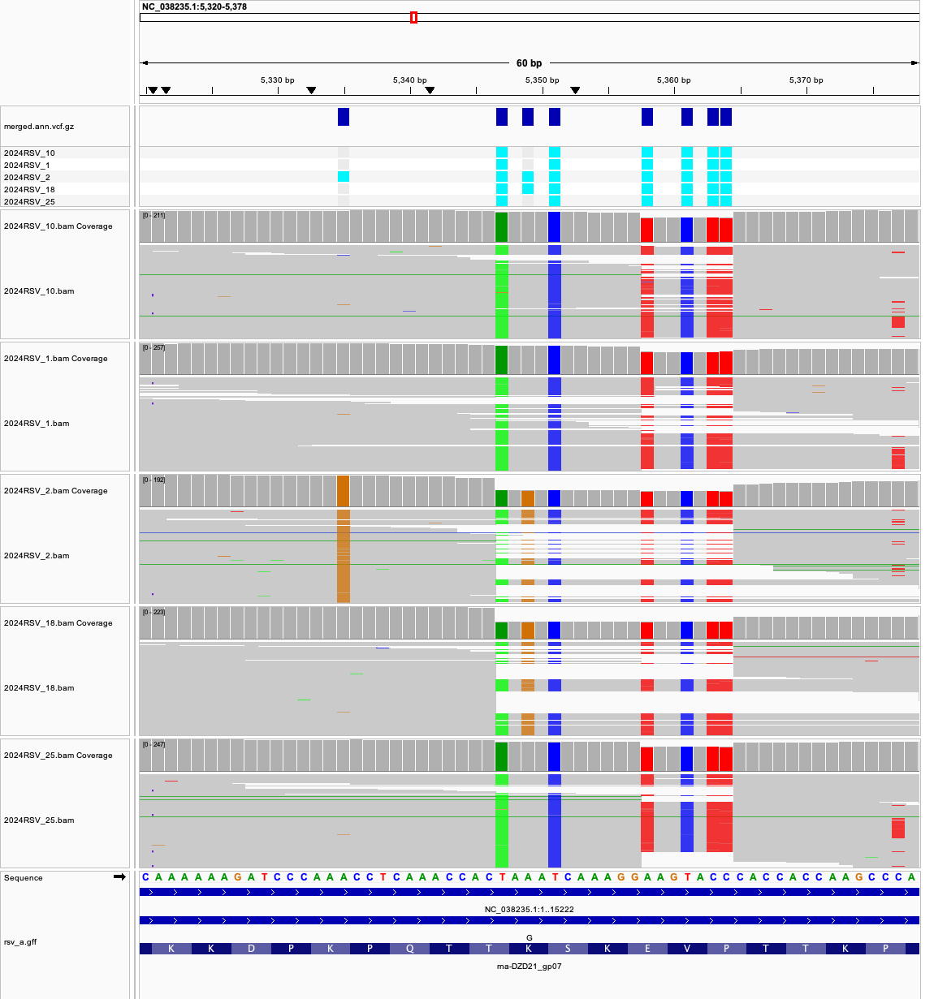
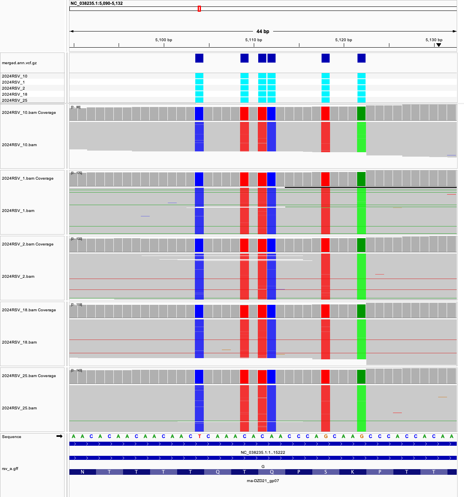

# Week 08 - Predict variant effects

I reused the [week07](../week07/) pipeline (reads → BAM → VCF) as a building
block and ran it on **five RSV-A samples** from the same study. I then called
variants on all five BAM files together to make a **multi-sample VCF**,
annotated it with **snpEff**, and tabulated the reference codon, alternate
codon and amino acid change of every coding SNP.

| | |
|---|---|
| Reference genome | RSV-A, RefSeq NC_038235.1 (assembly GCF_002815475.1), 15,222 bp, + its RefSeq GFF |
| BioProject | [PRJNA1358921](https://www.ncbi.nlm.nih.gov/bioproject/PRJNA1358921) (UNSW, 2024 RSV, Illumina MiSeq 2×151 bp) |
| Samples | 5 RSV-A runs, listed in [samples.csv](samples.csv) |
| Reads used (`N`) | first 5,000 read pairs per sample |
| Genetic code | standard (RSV is a human RNA virus; uses the standard code) |
| Outputs | `vcf/merged.vcf.gz`, `vcf/merged.ann.vcf.gz`, `results/coding_variants.tsv`, `results/snpEff_summary.html` |

## How to reproduce

Requirements (in the `bioinfo` environment, plus `fastq-dump` from
sra-tools): `make`, `curl`, `fastq-dump`, `seqkit`, `bwa`, `samtools`,
`bcftools`, `snpEff`, GNU `parallel`.

```bash
micromamba activate bioinfo

make all          # genome -> index -> all samples -> multi-sample VCF -> snpEff -> codon table
```

Individual steps:

```bash
make genome       # download the reference FASTA and GFF
make index        # bwa index the genome
make samples      # for every row of samples.csv: fastq -> align -> per-sample vcf (in parallel)
make sample SRR=SRR35979546 SAMPLE_NAME=2024RSV_1   # a single sample
make coverage     # samtools coverage of every BAM
make merge        # call variants on all BAMs together -> vcf/merged.vcf.gz
make snpeff       # build the snpEff database from the FASTA + GFF
make annotate     # snpEff ann -> vcf/merged.ann.vcf.gz + results/snpEff_summary.html
make codons       # results/coding_variants.tsv (ref/alt codon, amino acid, genotypes)
make clean        # remove reads, BAMs, VCFs and results
make realclean    # also remove the genome, index and snpEff database
```

To add or swap a sample, edit `samples.csv` (`sample,run`) and run
`make all` again.

```
week08/
├── Makefile
├── README.md
├── samples.csv      # design file: sample name, SRR run
├── codons.sh        # builds the codon table from the annotated VCF
├── metadata/        # run info for the whole BioProject (used to pick samples)
├── images/          # IGV screenshots
├── fasta/           # rsv_a.fa, rsv_a.gff, indexes
├── fastq/ bam/ vcf/ # per-sample reads, alignments, VCFs; merged VCFs
├── snpeff/          # snpEff config + custom database
└── results/         # snpEff summary, coding_variants.tsv
```

## Step 1: choosing the samples

`metadata/PRJNA1358921_runinfo.csv` lists the 100 runs of the study
that contains my week04–07 sample (2024RSV_10). About half are RSV-B, which
would not align well to the RSV-A reference, so I took my original sample
plus four other **RSV-A** runs with plenty of reads:

| Sample | Run | Reads mapped | Genome covered | Mean depth |
|---|---|---:|---:|---:|
| 2024RSV_10 | SRR35979456 | 9,785 | 98.4% | 91x |
| 2024RSV_1 | SRR35979546 | 9,308 | 98.2% | 86x |
| 2024RSV_2 | SRR35979545 | 9,777 | 98.4% | 91x |
| 2024RSV_18 | SRR35979537 | 9,784 | 97.6% | 91x |
| 2024RSV_25 | SRR35979533 | 9,730 | 98.4% | 91x |

## Step 2: the Makefile as a LEGO block

The per-sample part of the week07 Makefile is unchanged and is driven by
`SRR` and `SAMPLE_NAME`. `make samples` feeds the design file to GNU
`parallel`, which calls it once per row:

```make
samples: $(INDEX)
	cat $(DESIGN) | parallel --colsep , --header : -j $(JOBS) \
	    $(MAKE) sample SRR={run} SAMPLE_NAME={sample}
```

Each BAM gets a read group (`SM:<sample>`), which is how bcftools knows
which reads belong to which sample column.

## Step 3: multi-sample VCF

I used the **simultaneous calling** approach from the lecture: all BAM
files go into one `mpileup`, so every sample is genotyped at every candidate
site (no "holes" as with `bcftools merge`). The parameters are the same as
week07 (`--ploidy 1`, `-d 1000`, `QUAL<30 || DP<10` marked `LowQual`):

```make
bcftools mpileup $(ANN) -O u -f $(GENOME_FASTA) $(BAMS) \
    | bcftools call $(CALL) -mv -O u \
    | bcftools norm -f $(GENOME_FASTA) -d all -O u \
    | bcftools filter -s LowQual -e '$(FILTER)' -O u \
    | bcftools sort --write-index -O z -o $(MERGED)
```

Result: **849 sites, 847 SNPs and 2 insertions, 847 PASS** (the 2
`LowQual` are a 2-bp insertion at 1,094 and a SNP at 5,573). Most sites are
shared by all five viruses (they all differ from the old reference in the
same way); **22 coding SNPs differ between samples**. A genotype of `.` means
that sample had no reads there (e.g. 2024RSV_18 at 4,311 and 4,323, in the
low-coverage dip at the start of SH), which simultaneous calling can tell
apart from "matches the reference" (`0`).

## Step 4: variant effect prediction with snpEff

There is no prebuilt snpEff database for RSV, so `make snpeff` builds one
from the RefSeq FASTA and GFF (`snpEff build -gff3`), and `make annotate`
runs `snpEff ann` on the multi-sample VCF. I turned off
`upstream/downstream_gene_variant` (`-no-upstream -no-downstream`):
on a 15 kb genome every variant is "near" every gene, so these lines are
just noise.

**Fix needed for M2.** The RefSeq GFF attaches the two overlapping M2 ORFs
(M2-1, 7,606–8,190 and M2-2, 8,159–8,431) directly to the gene, next to an
mRNA with no gene. snpEff then glued both ORFs into one bogus transcript
called `rna-NC_038235.1:7597..8557` and produced nonsense such as
`p.Gly268*` in a 194-aa protein. The `snpeff` rule now rewrites the GFF so
each ORF has its own mRNA (`rna-M2-1`, `rna-M2-2`).

First (most severe) effect per variant:

| Effect | Count |
|---|---:|
| synonymous_variant | 522 |
| missense_variant | 148 |
| 3_prime_UTR_variant | 122 |
| intergenic_region | 37 |
| 5_prime_UTR_variant | 14 |
| stop_retained_variant | 2 |
| splice_region_variant | 2 |
| stop_gained | 1 |
| start_lost | 1 |

So most coding changes (77%) are synonymous, as expected for a virus under
purifying selection.

**The codon table.** snpEff's `ANN` field gives HGVS notation (`c.662A>G`,
`p.Lys221Arg`) but not the codons. `codons.sh` takes the CDS position from
`ANN`, cuts the codon out of the reference, swaps in the alternate base and
translates both with the standard code. Its amino acids match snpEff's for
every SNP, which is a good cross-check.

**SNPs in the same codon.** snpEff annotates one SNP at a time. In **22
codons** (46 SNPs) two or three SNPs hit the same codon in the same
samples, so the real codon carries all of them at once. `codons.sh`
also reports this `COMBINED_CODON`/`COMBINED_AA`, and for **35 of those 46
SNPs** the single-SNP prediction is wrong (example below).

## Step 5: annotated variants

Codons are written with the changed base(s) in uppercase. Positions are on
NC_038235.1; all RSV genes are on the + strand.

| # | POS | Gene | Change | Ref codon | Alt codon | Amino acid | snpEff effect | Samples with ALT |
|---|---:|---|---|---|---|---|---|---|
| 1 | 5,349 | G (attachment glycoprotein) | A>G | a**A**a | a**G**a | **Lys221Arg** (K→R) | missense | 2024RSV_2, 2024RSV_18 |
| 2 | 4,453 | SH (small hydrophobic) | C>A | **C**at | **A**at | **His51Asn** (H→N) | missense | 2024RSV_18 only |
| 3 | 5,083 | G | G>T | aa**G** | aa**T** | **Lys132Asn** (K→N) | missense | 2024RSV_25 only |
| 4 | 8,282 | M2 (M2-2 ORF) | A>T | **A**ac | **T**ac | **Asn42Tyr** (N→Y) | missense | 2024RSV_10, 2024RSV_1 |
| 5 | 6,487 | F (fusion glycoprotein) | A>G | a**A**c | a**G**c | **Asn276Ser** (N→S) | missense | all 5 |
| 6 | 3,968 | M (matrix) | T>C | ta**T** | ta**C** | Tyr236Tyr (Y→Y) | synonymous | 2024RSV_10, 2024RSV_1 |
| 7 | 5,111 + 5,112 | G | C>T + A>C | **CA**a | **TC**a | **Gln142Ser** (Q→S) | stop_gained + missense (**both wrong**, see below) | all 5 |
| 8 | 8,160 | M2 (M2-2 ORF) | T>C | a**T**g | a**C**g | Met1Thr, start codon lost | start_lost | all 5 |
| 9 | 10,757–10,759 | L (polymerase) | G>A, G>A, A>G | **GGA** | **AAG** | **Gly754Lys** (G→K) | 2× missense + synonymous (each SNP alone) | all 5 |

Notes on individual variants:

- **1, 2, 3, 4** are the missense changes that distinguish the samples, so
  they show how the five viruses differ from each other, not only from the
  reference. All are clean: e.g. at 5,349 2024RSV_2 has 73 of 74 reads and
  2024RSV_18 90 of 91 reads with `G`, and the other three have 0 of 148–182.
- **5, F Asn276Ser**: F is the target of the RSV antibodies (palivizumab,
  nirsevimab) and vaccines; N276S sits next to antigenic site II and is a
  well-known polymorphism of recent RSV-A viruses.
- **6** is a synonymous change for comparison: `TAT` and `TAC` both code
  for Tyr.
- **7, a stop codon that is not there.** Looked at alone, 5,111 C>T turns
  `CAA` (Gln) into `TAA` (stop) and snpEff calls it `stop_gained` (HIGH
  impact); 5,112 A>C alone would be `CCA` (Pro). But every read carries
  **both** changes, so the actual codon is `TCA` = **Ser**: a harmless
  Gln→Ser, not a truncated G protein. This is the main pitfall of
  per-SNP annotation tools.
- **8, M2-2 start lost.** The M2-2 ORF starts `ATG ACC ATG ...`; the first
  `ATG` becomes `ACG`, but there is another in-frame `ATG` two codons later
  (8,165), so M2-2 can most likely still start there, just 2 amino acids
  shorter. "start_lost" sounds severe but probably is not.
- **9**: three SNPs in one codon; snpEff reports Gly754Arg, Gly754Glu and
  Gly754Gly, but the real change is `GGA`→`AAG`, **Gly754Lys**.

The full list is in `results/coding_variants.tsv` (673 coding SNPs, one
column per sample genotype).

### IGV: variant 1 (G Lys221Arg) lined up with the translation

In IGV I loaded `fasta/rsv_a.fa` as the genome, then `fasta/rsv_a.gff`,
`vcf/merged.ann.vcf.gz` and the five BAM files, and zoomed in to
`NC_038235.1:5,320-5,378`. With the GFF track expanded, IGV draws the
amino acids of the G coding sequence at the bottom.



The VCF track has one row per sample (cyan = ALT, grey = REF). At 5,349
(middle base of the `AAA` codon translated as **K** under the reads), only
2024RSV_2 and 2024RSV_18 are cyan, and only their reads carry an orange
`G`: `AAA` → `AGA`, Lys → Arg. The other columns are shared by all five
samples. (2024RSV_2 also has a private synonymous `G` at 5,335, Lys216Lys,
visible as the orange column on the left.)

snpEff output for this variant (`INFO/ANN` in `vcf/merged.ann.vcf.gz`):

```
NC_038235.1  5349  .  A  G  468.993  PASS
ANN=G|missense_variant|MODERATE|G|gene-DZD21_gp07|transcript|rna-DZD21_gp07|protein_coding|1/1|c.662A>G|p.Lys221Arg|677/923|662/897|221/298||
```

i.e. allele `G`, missense, moderate impact, gene G, coding position 662 of
897, **amino acid 221 of 298, Lys→Arg**. Genotypes (`GT:DP:AD`):

```
2024RSV_10=0:148:148,0  2024RSV_1=0:177:177,0  2024RSV_2=1:74:1,73  2024RSV_18=1:91:1,90  2024RSV_25=0:182:182,0
```

And the line from `results/coding_variants.tsv`:

```
POS   REF ALT GENE EFFECT           HGVS_C   HGVS_P      REF_CODON ALT_CODON REF_AA ALT_AA CODON_SNPS COMBINED_CODON COMBINED_AA  10 1 2 18 25
5349  A   G   G    missense_variant c.662A>G p.Lys221Arg aAa       aGa       K      R      1          aGa            R            0  0 1 1  0
```

### IGV: variant 7 (G Gln142, the false stop codon)



At `NC_038235.1:5,090-5,132`, the `Q` (codon `CAA`, 5,110–5,112) has a red
`T` and a blue `C` in **every** read of every sample, right next to each
other: `CAA` → `TCA` (Ser). snpEff's output for the two SNPs taken
separately:

```
5111  T|stop_gained|HIGH|G|...|c.424C>T|p.Gln142*|...
5112  C|missense_variant|MODERATE|G|...|c.425A>C|p.Gln142Pro|...
```

## Summary

- The week07 Makefile worked unchanged as a per-sample block; a design
  file plus `parallel` ran it on 5 RSV-A samples (86–91x mean depth).
- Calling all five BAMs together gave **849 variant sites (847 PASS)**,
  almost all shared; 22 coding SNPs differ between samples.
- A custom snpEff database (with a fix for the overlapping M2 ORFs)
  annotated **522 synonymous and 148 missense** coding SNPs, plus 1
  stop_gained and 1 start_lost.
- Neither "severe" call holds up: the stop_gained is really **Gln142Ser**
  because a second SNP sits in the same codon, and the M2-2 start_lost has
  a backup `ATG` two codons downstream. Per-SNP annotation should always be
  checked against the codon in the reads.
