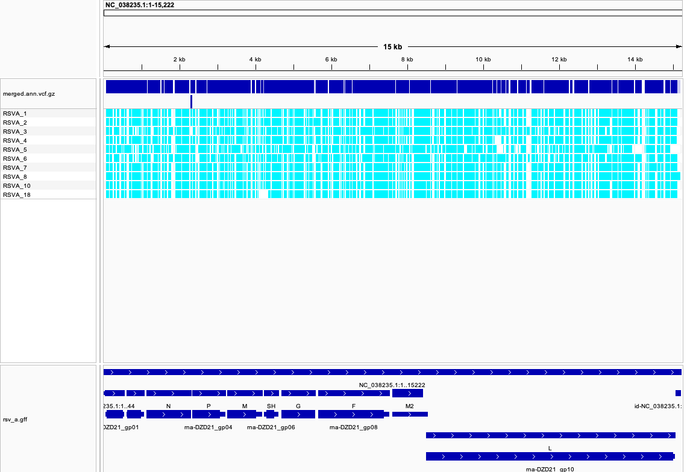
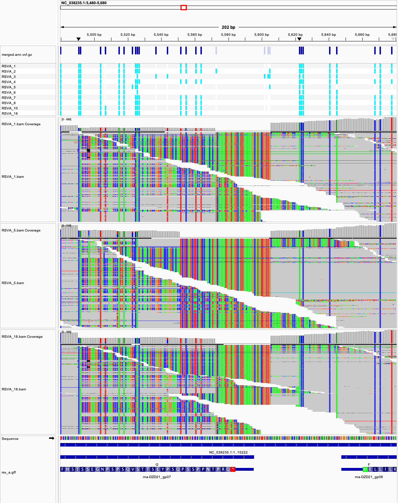
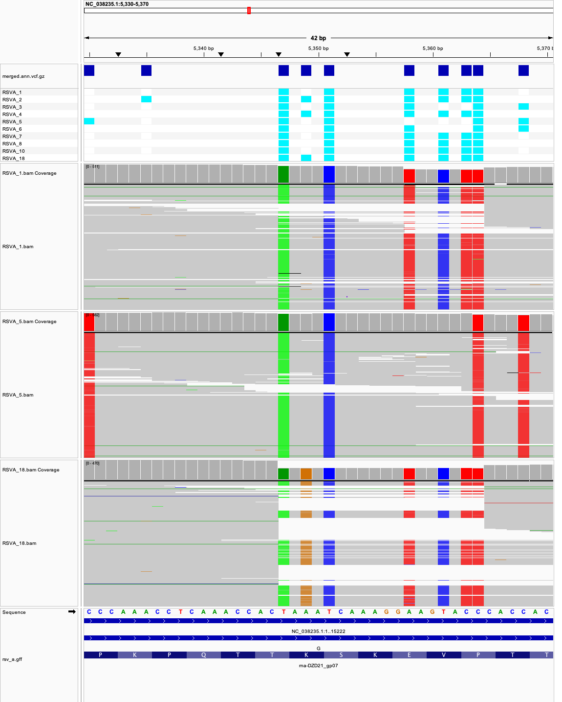

# Week 09 - Create a workflow

I turned the week07/08 pipeline (reads → BAM → VCF) into a workflow driven
by a **design file**: `make batch` reads `design.csv`, runs the per-sample
pipeline on **10 RSV-A samples** in parallel with GNU `parallel`, merges the
ten VCFs into **one VCF**, and annotates it with snpEff.

| | |
|---|---|
| BioProject | [PRJNA1358921](https://www.ncbi.nlm.nih.gov/bioproject/PRJNA1358921) |
| Reference genome | RSV-A, RefSeq NC_038235.1 (assembly GCF_002815475.1), 15,222 bp, + its RefSeq GFF |
| Design file | [design.csv](design.csv): all 100 runs of the BioProject |
| Samples processed | the first 10 RSV-A rows of `design.csv` (`NSAMPLES=10`) |
| Reads used (`N`) | first 10,000 read pairs per sample → 167–183x mean depth |
| Run time | about 30 s for the whole `make batch` on a laptop (`-j 4`), downloads included |
| Outputs | `vcf/merged.vcf.gz` (the merged VCF), `vcf/merged.ann.vcf.gz`, `vcf/joint.vcf.gz`, `results/coding_variants.tsv`, `results/snpEff_summary.html` |

## The BioProject

PRJNA1358921, *"Post-pandemic genomic surveillance of RSV in Sydney,
Australia"* (University of New South Wales; released May 2026), contains
**100 sequencing runs**, one per patient sample collected in Sydney in 2024.
Each is a whole-genome amplicon library (library selection: PCR, source: viral
RNA) sequenced on an **Illumina MiSeq, paired-end 2×151 bp**, with 46,000 to
280,000 read pairs per run.

- **68 runs are RSV-A** and **32 are RSV-B** (column `subtype`).
- The study tracks which RSV lineages circulated after the COVID-19
  pandemic, when RSV came back with unusual, out-of-season epidemics.

My week04–08 sample, 2024RSV_10 (SRR35979456), is one of these runs. The
reference genome is RSV-A, so the workflow processes only the RSV-A runs (an
RSV-B genome differs from it by about 20% and would align poorly).

## How to reproduce

Requirements (the `bioinfo` environment, plus `fastq-dump` from sra-tools):
`make`, `curl`, `fastq-dump`, `seqkit`, `bwa`, `samtools`, `bcftools`,
`snpEff`, GNU `parallel`. Rebuilding the design file also needs `bio` and
`csvtk`.

```bash
micromamba activate bioinfo

make batch
```

That single command:

1. downloads the genome and GFF and builds the `bwa` index **once**, before
   any parallel job starts (otherwise ten jobs would race to build the same
   index);
2. takes the header plus the first 10 `RSVA` rows of `design.csv` and runs
   `make all SRR=... SAMPLE=...` for each row, 4 at a time;
3. runs `make merge joint annotate codons`.

Other targets:

```bash
make                  # print the usage
make dryrun           # print the 10 per-sample commands without running them
make batch NSAMPLES=4 # fewer samples (or NSAMPLES=68 for every RSV-A run)
make batch JOBS=8     # more samples at the same time
make all SRR=SRR35979456 SAMPLE=RSVA_10   # one sample: genome -> fastq -> bam -> vcf
make stats SAMPLE=RSVA_10                 # flagstat + coverage of one BAM
make coverage         # coverage of every BAM in the batch
make merge            # bcftools merge of the per-sample VCFs -> vcf/merged.vcf.gz
make joint            # call all BAMs together -> vcf/joint.vcf.gz (for comparison)
make annotate         # snpEff -> vcf/merged.ann.vcf.gz + results/snpEff_summary.html
make codons           # results/coding_variants.tsv (codons, amino acids, genotypes)
make design           # rebuild design.csv from the BioProject (bio search)
make clean            # remove reads, BAMs, VCFs and results
make realclean        # also the genome, index and snpEff database
```

```
week09/
├── Makefile
├── README.md
├── design.csv       # design file: run_accession,sample,subtype,read_count
├── codons.sh        # codon table from the annotated VCF (from week08)
├── metadata/        # full SRA/ENA metadata of the BioProject (bio search)
├── images/          # IGV screenshots
├── fasta/           # rsv_a.fa, rsv_a.gff, indexes          (generated)
├── fastq/ bam/ vcf/ # reads, alignments, per-sample + merged VCFs (generated)
├── snpeff/          # snpEff config + custom database       (generated)
└── results/         # snpEff summary, coding_variants.tsv
```

## Step 1: one sample works

The per-sample part is the week07/08 pipeline, parametrized by `SRR` and
`SAMPLE`:

```bash
make all SRR=SRR35979456 SAMPLE=RSVA_10
```

`fastq-dump -X 10000` → `bwa mem` (with read group `SM:RSVA_10`) →
`samtools sort/index` → `bcftools mpileup | call --ploidy 1 | norm | filter`
(calls with `QUAL<30 || DP<10` are kept but marked `LowQual`). For RSVA_10
this gives 822 variants, 801 PASS.

## Step 2: the design file

`make design` builds `design.csv` from the BioProject:

```bash
bio search -H --csv PRJNA1358921 > metadata/PRJNA1358921.csv
```

and keeps four columns: `run_accession`, `sample`, `subtype`, `read_count`.
The SRA sample alias (`2024RSV_10`) starts with a number, which breaks the
design-file rules, so the sample name comes from the library name instead
(`RSVA/RSV_10` → `RSVA_10`). Rows are sorted by subtype and sample number.

```
run_accession,sample,subtype,read_count
SRR35979546,RSVA_1,RSVA,127946
SRR35979545,RSVA_2,RSVA,187070
SRR35979517,RSVA_3,RSVA,152370
...
SRR35979476,RSVB_43,RSVB,86366
```

## Step 3: the `batch` target

```make
# Rows to process: header + first NSAMPLES of SUBTYPE
SELECT = awk -F, 'NR == 1 || $$3 == "$(SUBTYPE)"' $(DESIGN) | head -n $$(($(NSAMPLES) + 1))

PARALLEL = parallel --colsep , --header : --eta --lb -j $(JOBS)

batch: genome index
	$(SELECT) | $(PARALLEL) \
	    $(MAKE) all SRR={run_accession} SAMPLE={sample} N=$(N)
	$(MAKE) merge joint annotate codons NSAMPLES=$(NSAMPLES)
```

`make dryrun` shows what will run:

```
make all SRR=SRR35979546 SAMPLE=RSVA_1 N=10000
make all SRR=SRR35979545 SAMPLE=RSVA_2 N=10000
...
make all SRR=SRR35979537 SAMPLE=RSVA_18 N=10000
```

The ten samples (RSVA_1 to RSVA_8, RSVA_10 and RSVA_18) all reached a
realistic depth for variant calling:

| Sample | Run | Genome covered | Mean depth | Variants (PASS) |
|---|---|---:|---:|---:|
| RSVA_1 | SRR35979546 | 98.2% | 171x | 810 |
| RSVA_2 | SRR35979545 | 98.5% | 183x | 819 |
| RSVA_3 | SRR35979517 | 98.4% | 181x | 799 |
| RSVA_4 | SRR35979483 | 97.3% | 172x | 776 |
| RSVA_5 | SRR35979514 | 94.5% | 167x | 736 |
| RSVA_6 | SRR35979473 | 98.4% | 174x | 794 |
| RSVA_7 | SRR35979519 | 98.5% | 176x | 821 |
| RSVA_8 | SRR35979498 | 99.0% | 181x | 809 |
| RSVA_10 | SRR35979456 | 98.5% | 182x | 801 |
| RSVA_18 | SRR35979537 | 98.2% | 183x | 800 |

## Step 4: merging into a single VCF

```make
bcftools merge -F x -O z -o vcf/merged.vcf.gz --write-index $(VCFS)
```

Result: **1,049 sites (1,047 SNPs, 2 insertions), 1,031 PASS**. Two details:

- **`-F x`.** By default, `bcftools merge` marks a site `LowQual` if *any*
  sample's call was `LowQual`, even when the other nine called it with
  QUAL 228. With the default, 80 sites were `LowQual`; with `-F x` a site is
  PASS if it passed in at least one sample, leaving 18 `LowQual` sites. These
  are mostly single-sample calls supported by 1–6 reads.
- **Missing genotypes.** The per-sample VCFs only list variant sites, so in
  the merged VCF a sample without a call gets `.`, which can mean either
  "matches the reference" or "no reads". For comparison, `make joint`
  calls all ten BAMs together, which tells these apart. Of the 2,371 `.`
  genotypes in `merged.vcf.gz`, the joint call reports **2,129 as reference
  (`0`)** and only **182 as truly uncovered**. The site lists are the same
  (1,049 vs 1,048 records), so I use the merged VCF for annotation and the
  joint VCF when I need to know that a sample is really reference.

snpEff, using the week08 database (with the fix for the overlapping M2 ORFs),
gives as the first effect of each PASS variant: 617 synonymous, 181 missense,
123 3'UTR, 37 intergenic, 4 5'UTR, 2 stop_retained, 2 splice_region,
1 stop_gained and 1 start_lost.

## Step 5: results in IGV

### Whole genome: the merged VCF

`fasta/rsv_a.fa` as the genome, plus `vcf/merged.ann.vcf.gz` and
`fasta/rsv_a.gff`:



Each row is one sample (cyan = ALT). Most columns are cyan in all ten rows:
**615 sites are ALT in every sample**. These are differences between the
2024 viruses and the old reference strain, not between patients. RSVA_5
(row 5) has a visibly different pattern.

### Finding 1: the samples form three groups

Pairwise number of PASS SNPs that differ between two samples (from
`vcf/joint.vcf.gz`, counting only sites where both samples have reads):

| | 1 | 2 | 3 | 4 | 5 | 6 | 7 | 8 | 10 | 18 |
|---|---:|---:|---:|---:|---:|---:|---:|---:|---:|---:|
| **RSVA_1** | 0 | 13 | 144 | 14 | 262 | 148 | 5 | 1 | 6 | 13 |
| **RSVA_2** | 13 | 0 | 147 | 13 | 265 | 151 | 16 | 14 | 17 | 8 |
| **RSVA_3** | 144 | 147 | 0 | 146 | 238 | 63 | 147 | 145 | 148 | 140 |
| **RSVA_4** | 14 | 13 | 146 | 0 | 262 | 150 | 17 | 15 | 12 | 7 |
| **RSVA_5** | 262 | 265 | 238 | 262 | 0 | 242 | 265 | 263 | 264 | 258 |
| **RSVA_6** | 148 | 151 | 63 | 150 | 242 | 0 | 151 | 149 | 150 | 144 |
| **RSVA_7** | 5 | 16 | 147 | 17 | 265 | 151 | 0 | 4 | 9 | 16 |
| **RSVA_8** | 1 | 14 | 145 | 15 | 263 | 149 | 4 | 0 | 7 | 14 |
| **RSVA_10** | 6 | 17 | 148 | 12 | 264 | 150 | 9 | 7 | 0 | 11 |
| **RSVA_18** | 13 | 8 | 140 | 7 | 258 | 144 | 16 | 14 | 11 | 0 |

- **Seven samples (1, 2, 4, 7, 8, 10, 18) are nearly identical**, 1–17 SNPs
  apart (≤0.1% of the genome). RSVA_1 and RSVA_8 differ at a single position.
  This is what one lineage spreading through a city during one season looks
  like.
- **RSVA_3 and RSVA_6** form a second group (63 SNPs apart from each other,
  about 145 from the main group).
- **RSVA_5** is about 240–265 SNPs from everybody, a third, more distant
  lineage. It also has the lowest genome coverage (94.5%), which is expected
  if its sequence differs more from the amplicon primers and the reference.

So at least three RSV-A lineages co-circulated in Sydney in 2024. Many
genotypes in the merged VCF reflect these groups, e.g. `11.1..1111` (ALT in
the main group, absent in 3, 5 and 6).

### Finding 2: all ten carry the 72-nt duplication in G



At the end of the G gene (`NC_038235.1:5,480-5,680`, shown with soft-clipped
bases on) every sample shows the same pattern: a staircase of reads whose ends
are soft-clipped (coloured blocks), a drop in coverage between about 5,570
and 5,605, and a pile of reads that all start at **5,606** with 50–100 clipped
bases (e.g. CIGAR `72S79M`). Reads containing extra sequence that matches a
stretch just upstream cannot be aligned end to end, so `bwa` clips them.
This is the **72-nucleotide duplication in the G ectodomain** that defines
the ON1 genotype (lineage A.D), which has replaced the older RSV-A genotypes
worldwide since 2010. The A2-era reference does not have it. Because the
reads are short (151 bp), `bwa` cannot call this as a 72-bp insertion, so
**the duplication is not in the VCF at all**. It is visible only in the
alignments.

### Finding 3: a G-protein change that tracks the groups



At `NC_038235.1:5,330-5,370` (G, with its translation at the bottom), the
VCF rows show columns that split the samples. At **5,349** (`AAA` → `AGA`,
**Lys221Arg**) only RSVA_2, RSVA_4 and RSVA_18 carry the orange `G`. These are
the three samples that are closest to each other within the main group
(7–13 SNPs apart). The groups from Finding 1 show up too. RSVA_3, RSVA_5 and
RSVA_6 lack Val225Ala and Pro226Ser (5,361 and 5,363), which the main group
carries. Those three share a synonymous `T` at 5,368 (Thr227Thr). RSVA_5 alone
lacks Glu224Val (5,358) and has a private Pro215Ser (5,330). G is the most variable RSV protein
(it is under antibody pressure), so the lineage differences concentrate here.

### Finding 4: no changes in the nirsevimab binding site of F

F is the target of the monoclonal antibodies nirsevimab (Beyfortus, given to
infants in Australia from 2024) and palivizumab, and of the new vaccines.
`results/coding_variants.tsv` lists 23 missense changes in F. Most, for
example **Asn276Ser** next to antigenic site II, are shared by all ten
samples and are typical of current ON1 viruses. The changes that differ
between samples (Thr103Ala, Ala122Thr, Val127Ile, Lys132Ile, Ser377Asn,
Ile379Met, Val384Ile) are all **outside site Ø** (F residues 62–69 and
196–212), where nirsevimab binds and where escape mutations such as N67I or
N208Y have been reported. None of these ten 2024 viruses has a known
resistance mutation.

### Caveat: per-SNP annotation

As in week08, snpEff annotates each SNP alone. At G codon 142 two SNPs sit
in the same codon (`CAA` → `TCA`), so snpEff's `stop_gained` at 5,111 is
really a harmless **Gln142Ser**. The `COMBINED_CODON` and `COMBINED_AA`
columns of `results/coding_variants.tsv` apply all SNPs in a codon together.
RSVA_5 has a different third allele at 5,112 (`GT=2` in the VCF), which is
another sign that it belongs to a separate lineage.

## Summary

- `design.csv` describes all 100 runs of PRJNA1358921 (68 RSV-A, 32 RSV-B).
  `make batch` runs the single-sample Makefile on the first 10 RSV-A runs with
  `parallel`, then merges, annotates and tabulates them. One command takes it
  from nothing to a merged, annotated VCF.
- At 10,000 read pairs per sample (167–183x), all ten samples had 94–99% of
  the genome covered.
- The merged VCF has 1,049 sites (1,031 PASS). Use `-F x` with `bcftools merge`;
  the default flags well-supported sites as `LowQual`. Remember that a `.`
  in a merged VCF is usually "reference", not "no data".
- The ten viruses fall into three lineages. All carry the ON1 72-nt G
  duplication, which shows up only in the alignments, not in the VCF. None
  has a change in the nirsevimab binding site.
