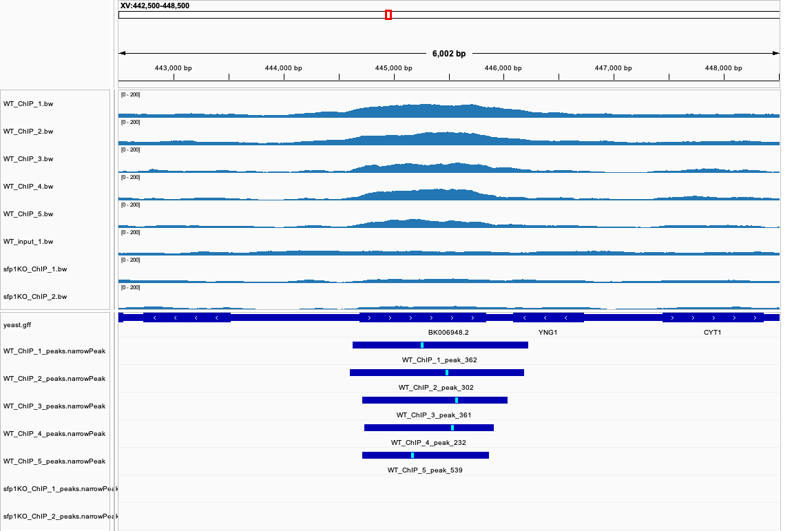
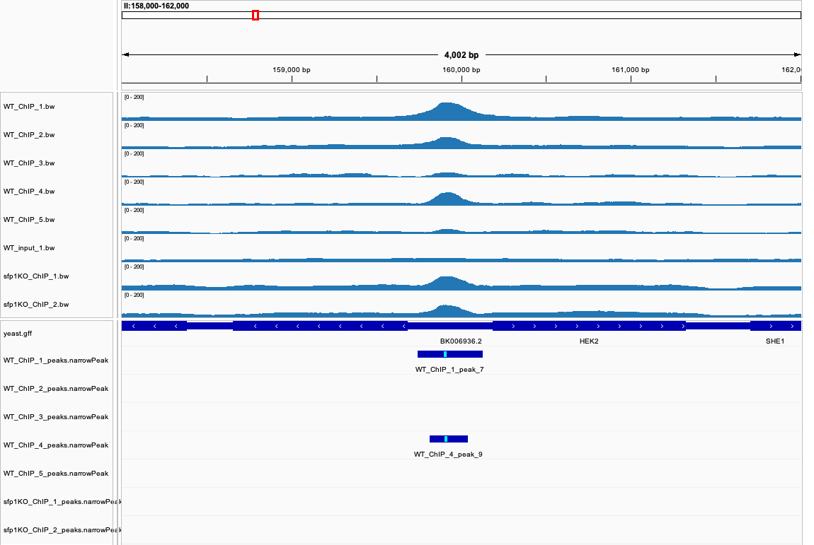
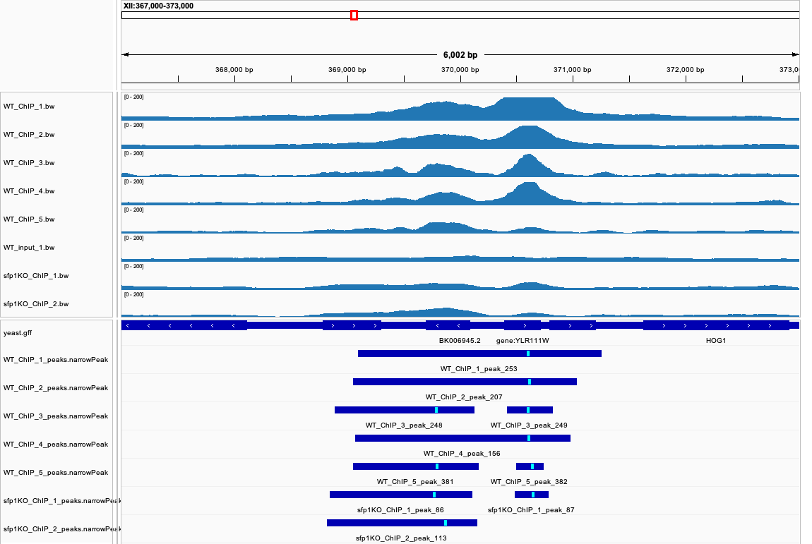

# Week 10 - ChIP-seq peak calling

I reused the [week09](../week09/) workflow (a single-sample Makefile run from
the outside with `parallel` and a design file) and replaced variant calling with
**peak calling**: reads → BAM → coverage track, then ChIP + input → MACS3 peaks.

RSV has no ChIP-seq data because it is an RNA virus, so I switched genomes to
budding yeast. Its 12 Mb genome is small enough to process many samples on a
laptop.

| | |
|---|---|
| BioProject | [PRJNA488473](https://www.ncbi.nlm.nih.gov/bioproject/PRJNA488473), "SFP1 (ChIP-seq)" |
| Assay | ChIP-seq, Illumina HiSeq 2500, paired-end 2×25 bp |
| Organism and genome | *Saccharomyces cerevisiae* S288C, R64-1-1 (Ensembl release 116), 12.2 Mb |
| Samples used | 14 of the project's 18 *S. cerevisiae* runs, listed in [design.csv](design.csv) |
| Reads used (`N`) | first 3,000,000 read pairs per sample |
| Run time | about 16 minutes for `make batch` (2 jobs × 4 threads), 16 GB of FASTQ |
| Outputs | `peaks/*_peaks.narrowPeak`, `bw/*.bw`, `results/peak_counts.tsv`, `results/replicate_pairs.tsv`, `results/WT_peak_support.tsv` |

## The project

The study asks how the binding targets of the transcription factor **Sfp1**
evolved. It has 70 runs from four yeast species (*K. lactis*, *N. castellii*,
*S. paradoxus* and *S. cerevisiae*). In each species, an antibody against Sfp1
was used for ChIP, and the *SFP1* deletion strain served as a control.

I used the *S. cerevisiae* wild type and deletion samples:

| Group | Role | ChIP replicates | Input replicates |
|---|---|---:|---:|
| `WT` | **condition**: anti-Sfp1 ChIP in cells that have Sfp1 | 5 | 5 |
| `sfp1KO` | **control**: the same antibody in cells without Sfp1 | 2 | 2 |

There are two kinds of control here. The **input** of each ChIP is the
background for MACS3. It corrects for how easily each region is fragmented and
sequenced. The **deletion strain** shows what the antibody and the procedure
pull down when Sfp1 is absent, so a peak found there cannot be Sfp1 binding.

I left out the four Sfp1-HA runs, which use a different antibody and strain.

## How to reproduce

Requirements (the `bioinfo` environment, plus `fastq-dump` from sra-tools):
`make`, `curl`, `fastq-dump`, `seqkit`, `bowtie2`, `samtools`, `bedtools`,
`bedGraphToBigWig`, `macs3`, GNU `parallel`. I added MACS3 this week with:

```bash
micromamba install -n bioinfo -c bioconda -c conda-forge macs3
```

Then:

```bash
micromamba activate bioinfo

make batch
```

`make batch` runs three steps in order:

1. `make background` downloads the genome, builds the index once, then processes
   the 7 input samples.
2. `make chip` processes the 7 ChIP samples and calls peaks against their inputs.
   The inputs have to exist first, because each peak call needs its control BAM.
3. `make compare` writes the tables in `results/`.

Other targets:

```bash
make                  # print the usage
make dryrun           # print the 14 per-sample commands without running them
make all SRR=SRR7767717 SAMPLE=WT_input_1                       # one sample: reads -> BAM -> coverage
make all peaks SRR=SRR7767712 SAMPLE=WT_ChIP_1 CONTROL=WT_input_1   # one ChIP sample + its peaks
make stats SAMPLE=WT_ChIP_1   # bowtie2 log and flagstat of one sample
make batch N=1000000  # fewer reads for a quick test (run make clean first)
make clean            # remove reads, BAMs, tracks, peaks and results
make realclean        # also the genome and index
```

```
week10/
├── Makefile
├── README.md
├── design.csv       # run,sample,group,type,replicate,control
├── compare.sh       # peak counts and replicate agreement
├── metadata/        # full metadata of the BioProject (bio search)
├── images/          # IGV screenshots
├── results/         # the three summary tables
└── fasta/ fastq/ bam/ bw/ peaks/   # generated
```

## What changed from week09

- **Design file.** I built it by hand from `bio search -H --csv PRJNA488473`,
  because the sample type is only in the free-text description
  (`Scer_WT_IP1_1` → `WT_ChIP_1`, `Scer_Sfp1d_input_1` → `sfp1KO_input_1`). Each
  ChIP row names its background in the `control` column. I paired ChIP and input
  by replicate number, which is an assumption based on the sample names.
- **Aligner: `bowtie2` instead of `bwa mem`.** By default `bwa mem` discards
  alignments that score below 30, so 25 bp reads would never pass. The authors
  also used bowtie2.
- **Filtering.** I keep concordant pairs with MAPQ ≥ 20. This removes reads that
  map to several places equally well.
- **Coverage tracks.** Fragment coverage from `bedtools genomecov -pc`, scaled to
  fragments per million so that tracks from different samples are comparable.
- **Peak calling.** Sfp1 is a transcription factor, so I used narrow peaks:

```make
macs3 callpeak -f BAMPE -g 1.2e7 -q 0.01 -t $(BAM) -c $(CONTROL_BAM) -n $(SAMPLE) --outdir peaks/
```

`-f BAMPE` uses the real fragments from the read pairs instead of estimating
their length. `-g 1.2e7` is the yeast genome size. `-q 0.01` is the 1% false
discovery rate used in the course material.

## How many peaks in each sample?

From `results/peak_counts.tsv`. Fragments are those left after filtering, and
FRiP is the percentage of them that fall inside that sample's peaks.

| Sample | Group | Fragments | Peaks | FRiP |
|---|---|---:|---:|---:|
| WT_ChIP_1 | WT | 1,516,700 | 413 | 9.3% |
| WT_ChIP_2 | WT | 1,712,940 | 344 | 6.4% |
| WT_ChIP_3 | WT | 543,630 | 400 | 6.4% |
| WT_ChIP_4 | WT | 731,304 | 256 | 4.9% |
| WT_ChIP_5 | WT | 1,622,323 | 609 | 6.9% |
| sfp1KO_ChIP_1 | sfp1KO | 2,005,221 | 124 | 2.0% |
| sfp1KO_ChIP_2 | sfp1KO | 2,109,518 | 172 | 2.6% |

The WT samples have 2–3 times as many peaks as the deletion samples, and about
3 times the FRiP, even though they have fewer usable fragments. That is the
expected direction if the antibody is enriching for Sfp1.

**Why the fragment counts differ.** All samples started with 3 million pairs, yet
WT_ChIP_3 kept only 543,630. I re-aligned the first 200,000 pairs without the
MAPQ filter and counted those landing in the rDNA repeat on chromosome XII:

| Sample | Pairs in the rDNA repeat |
|---|---:|
| WT_ChIP_3 | 77.9% |
| WT_ChIP_1 | 39.4% |
| WT_input_1 | 6.8% |

These reads map to many copies of the repeat, so the MAPQ filter removes them.
In some WT replicates most of the sequencing went to the rDNA, which leaves much
less data for the rest of the genome and is a real difference between libraries.

## How consistent are the replicates?

Only moderately, when judged by the peak calls. From
`results/replicate_pairs.tsv`, for each pair of replicates:

| Group | Pairs | Peaks of one replicate also found in the other | Jaccard index |
|---|---:|---:|---:|
| WT | 10 | 36–85% | 0.28–0.48 |
| sfp1KO | 1 | 45–63% | 0.34 |

To see the pattern, I merged the WT peaks into 775 regions and counted how many
of the five replicates have a peak in each (`results/WT_peak_support.tsv`):

| WT replicates with a peak | Regions | Mean width | Median best −log10(q) | Nearest gene is RPL/RPS | Also a peak in sfp1KO |
|---:|---:|---:|---:|---:|---:|
| 1 | 272 | 376 bp | 4.7 | 6% | 8% |
| 2 | 158 | 535 bp | 14.6 | 11% | 9% |
| 3 | 137 | 631 bp | 24.4 | 19% | 15% |
| 4 | 91 | 855 bp | 13.3 | 22% | 26% |
| 5 | 117 | 1,470 bp | 23.3 | 31% | 68% |

- **More than half of the regions (430 of 775) are in only one or two
  replicates.** Those seen once are narrow and weak, as expected for peaks close
  to the significance cutoff.
- **The 117 regions in all five are enriched for ribosomal protein genes.** For
  31% of them the nearest gene is an RPL or RPS gene, compared with 2% of all
  protein-coding genes (132 of 6,600). Sfp1 is known as a regulator of ribosomal
  protein and ribosome biogenesis genes, so this supports the calls.
- **Reproducible does not mean specific.** 79 of those 117 regions also have a
  peak in the deletion strain, where Sfp1 cannot be the cause. Only 38 are in all
  five WT replicates and in neither deletion replicate. Those 38 include 13 RPL
  or RPS genes, plus `RPP1B`, `ASC1`, `TEF1` and `TEF4`, so I consider this the
  most trustworthy set.

## IGV: where replicates agree and where they do not

I loaded the genome, `fasta/yeast.gff`, the `bw/*.bw` coverage tracks and the
`peaks/*.narrowPeak` files. All coverage tracks use the same 0–200 scale. Peak
files are the bars below the gene track, with the summit in cyan. The gene track
is collapsed, so some gene labels are hidden or replaced by the chromosome's ID
(`BK006948.2`); I give the gene coordinates in the text.

### Replicates agree: RPL3 (`XV:442,500-448,500`)



All five WT replicates have raised signal and a peak over **RPL3**
(444,686–445,849), with similar boundaries. The input and both deletion samples
are flat, and neither deletion sample has a peak. This is the pattern expected
for an Sfp1-dependent region.

The signal covers the whole gene rather than a sharp point at the promoter, so
this is not a typical narrow transcription factor peak. *RPL3* is also very
highly transcribed, and deleting *SFP1* may lower that, so ChIP alone cannot show
that Sfp1 contacts this DNA directly.

### Replicates disagree: upstream of RIB1 (`II:158,000-162,000`)



MACS3 called a peak here only in **WT_ChIP_1 and WT_ChIP_4**, just upstream of
*RIB1* (a riboflavin synthesis gene, 158,656–159,693 on the − strand). The tracks
explain why this is less clear than the calls suggest:

- The bump is present in all five WT replicates. It is only weak in 3 and 5, so
  it falls below the cutoff in some of them. The difference is partly in the
  thresholding, not all-or-nothing.
- **The deletion samples have the same bump**, although MACS3 called no peak
  there. So even though the table lists this region as `ko_reps = 0`, the signal
  is probably not caused by Sfp1.

This is why peak calls should be checked against the coverage tracks: the number
of peaks shared depends on a cutoff, not just on the underlying signal.

### Same signal without Sfp1: CCW12 (`XII:367,000-373,000`)



This is one of the 79 reproducible regions that also has peaks in the deletion
strain. The signal around the highly expressed cell wall gene *CCW12* is strong
in WT and clearly present in the deletion samples, though weaker. Some regions
may be recovered by ChIP regardless of the target ("hyper-ChIPable" regions), and
without the deletion control these would have looked like top Sfp1 targets.
It also shows a counting problem: the same signal is one peak in replicates 1, 2
and 4 but two peaks in 3 and 5, because of their different depths.

## Caveats

- **Problem regions.** The ENCODE blacklist does not cover yeast. The strongest
  call in every WT sample is at the rDNA repeat (`XII:459,510-460,981`), driven by
  repeat copies. `compare.sh` flags peaks in the rDNA and mitochondrial genome.
  Only 2 of the 775 regions are flagged, and the tables above still include them.
- **Nearest gene is only a first guess.** A peak between two divergent genes is
  assigned to just one of them.
- **Unequal replicates.** There are 5 WT but only 2 deletion replicates, and I
  used a subset of the reads. A peak "absent" in the deletion strain has less
  chance of being seen than one absent in WT.

## Summary

- `make batch` goes from `design.csv` to peaks, coverage tracks and summary tables
  for 14 samples: the week09 structure with peak calling in place of variant
  calling.
- MACS3 called **256–609 peaks per WT replicate** and **124–172 per deletion
  replicate**.
- Replicates agree moderately (Jaccard 0.28–0.48 in WT). Of 775 WT regions, 117
  are in all five replicates, and these are enriched for ribosomal protein genes
  (31% vs 2% genome-wide).
- The deletion control matters: 79 of those 117 also have peaks without Sfp1,
  leaving **38 regions** as the most confident Sfp1-dependent set.
