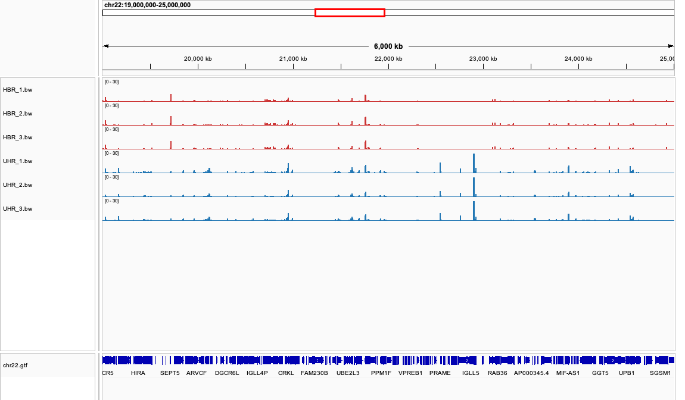
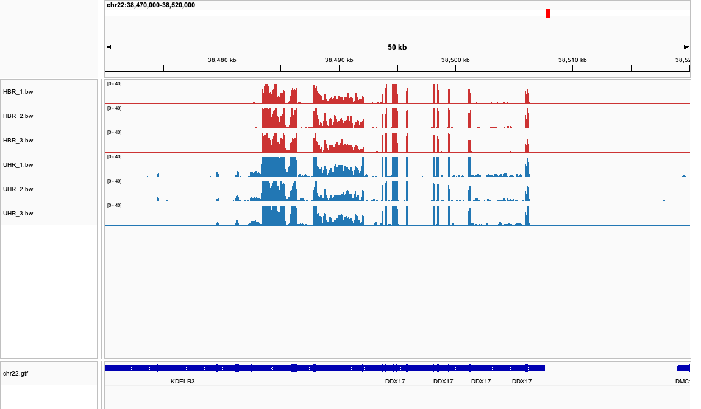
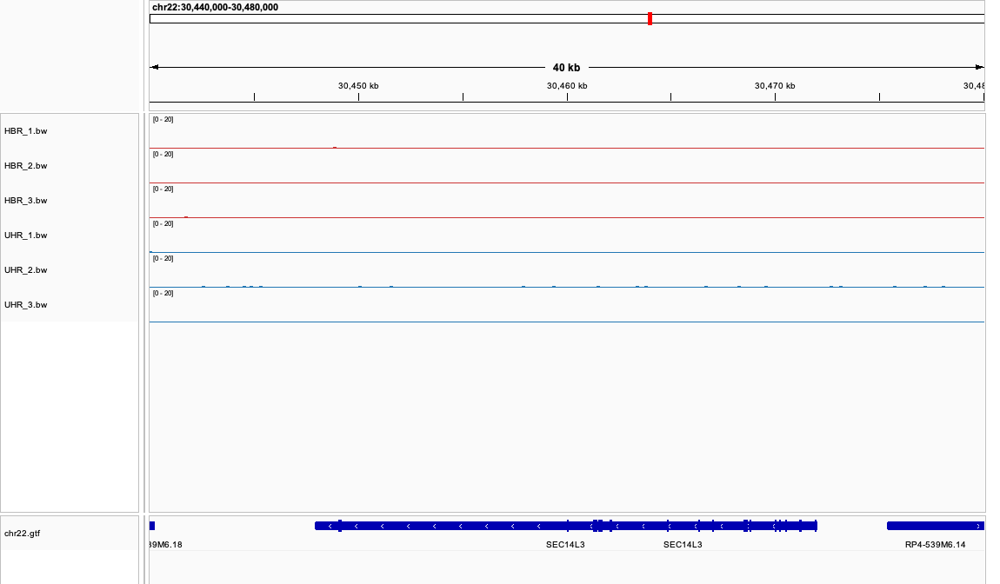
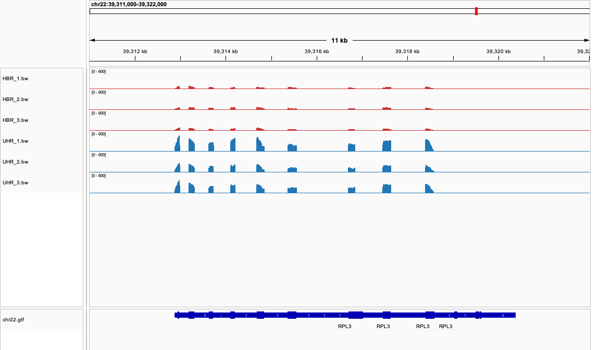
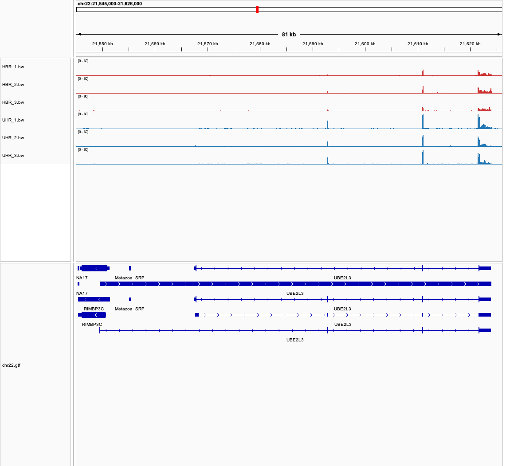
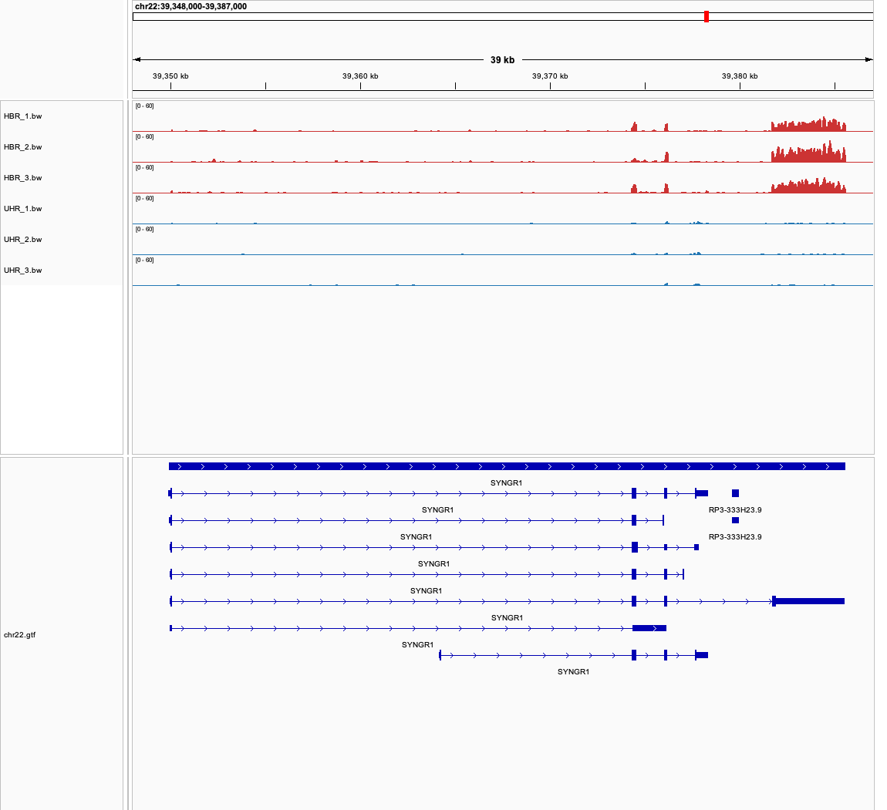

# Week 11 - Evaluate gene expression

I repeated the steps from the course's Genome-based RNA-Seq page, generated a coverage file for each sample, and looked at them in IGV to
answer the questions below. The Makefile here is the course's unmodified
`rnaseq.hisat.2026.mk`.

| | |
|---|---|
| Data | RNA-Seq tutorial data: single-end 100 bp reads that align to chromosome 22 |
| Reference | `fasta/chr22.genome.fa`, annotation `gtf/chr22.gtf` (1,371 genes, 438 protein-coding) |
| Samples | 3 replicates each of **HBR** (Human Brain Reference) and **UHR** (Universal Human Reference, 10 cancer cell lines) |
| Tools | `hisat2`, `samtools`, `bamCoverage` (deepTools), `featureCounts` |
| Outputs | `bam/*.bam`, `bw/*.bw`, `counts/*.txt` |

## How to reproduce

```bash
micromamba activate bioinfo

make data     # download and unpack the tutorial data
make batch    # build the index, then align, make coverage and count every sample in design.csv
make igv      # load the genome, the GTF and the coverage files into a running IGV
```

The steps take about 20 seconds after the download. `bamCoverage` needed
`deeptools`, which I added with
`micromamba install -n bioinfo -c bioconda -c conda-forge deeptools`.

In IGV, I colored HBR **red** and UHR **blue**, and gave all six tracks the same
scale in each screenshot.

The coverage tracks are **raw depth, not normalized**. UHR libraries are
somewhat larger, so UHR tracks look a little taller for that reason alone:

| Sample | HBR_1 | HBR_2 | HBR_3 | UHR_1 | UHR_2 | UHR_3 |
|---|---:|---:|---:|---:|---:|---:|
| Mapped reads | 62,528 | 76,030 | 68,365 | 108,929 | 83,216 | 87,023 |

The questions are answered by eye in IGV. I also used the `featureCounts` tables
and splice junction counts from the BAM files to find candidate genes and check
what I saw. CPM below means counts per million mapped chr22 reads.

## 1. How are the two sample types different across a wide region?



At `chr22:19,000,000-25,000,000`, the three red tracks look like each other and
the three blue tracks look like each other, but the two colors do not match.
Expression is a set of narrow spikes at genes, and many spikes are present in one
type and not the other. The most obvious is the tall UHR-only spike near 22.9 Mb,
in the immunoglobulin lambda region labeled `IGLL5`. It has 218–247 reads in each
UHR sample and 0–3 in HBR. Immunoglobulin expression fits a cell-line mix better
than brain, although I can't tell from this data which cell line it comes from.

Over the protein-coding genes that are expressed (327 with a mean of at least 100
CPM in one group), 53 are at least 4-fold higher in HBR and 37 at least 4-fold
higher in UHR.

## 2. How consistent are the replicates?



Very consistent. At *DDX17* (above), replicates have the same exon pattern and
nearly the same shape, including the small bumps inside exons. The same is true
across the rest of the chromosome. Differences between replicates are mostly in
overall height, which follows library size, and in the exact height of individual
positions in low-coverage genes.

The correlation of log2 CPM across the 489 genes with at least 10 reads agrees:

| Comparison | Pearson r |
|---|---:|
| Within HBR | 0.90–0.92 |
| Within UHR | 0.91–0.93 |
| HBR vs UHR | 0.49–0.51 |

Both samples are commercial RNA pools, so these replicates are probably closer to
technical replicates than to independent biological samples. Their agreement
says little about how much expression varies between people.

## 3. A gene that is not expressed in any sample: SEC14L3



*SEC14L3* (`chr22:30,447,959-30,472,049`, − strand, protein-coding) has no exon
coverage in any sample: the maximum depth over its 3,663 exonic bases is 1. UHR_2
has a few isolated reads spread evenly across this window, inside and outside the
gene and not matching the exons, which looks like background rather than
expression. `featureCounts` finds 27 protein-coding genes with zero reads in all
six samples, and *SEC14L3* is one of the longest.

## 4. A gene that is very strongly expressed in all samples: RPL3



*RPL3* (`chr22:39,312,882-39,320,389`, − strand) is a ribosomal protein gene, so
it is expected in essentially all cells. It stands out in all six samples, and
every coding exon is covered. Its coverage over all annotated exons, using
`samtools depth`:

| Sample | HBR_1 | HBR_2 | HBR_3 | UHR_1 | UHR_2 | UHR_3 |
|---|---:|---:|---:|---:|---:|---:|
| Mean exon depth | 14× | 16× | 15× | 84× | 50× | 63× |
| Peak depth | 100× | 97× | 103× | 564× | 330× | 453× |

The mean is lower than what you see in the tall exons, because it also includes
annotated regions from other isoforms that have little coverage. RPL3 is also a
good reminder that "expressed in all" does not mean equal: it is about 3 times
higher in UHR after normalizing for library size (33,518 vs 10,326 CPM). That is
reasonable for fast-growing cancer cells, which need many ribosomes.

## 5. Can you identify the transcripts that are expressed? UBE2L3



Mostly you can only exclude candidates. *UBE2L3* has four annotated transcripts.
This table combines the coverage in IGV with the reads spanning each splice
junction (total across six samples):

| Transcript | What is distinctive | Evidence | Verdict |
|---|---|---|---|
| `UBE2L3-001` | All four exons in the usual order | Junctions have 11, 126 and 190 reads, the only transcript with all supported | **Most likely expressed** |
| `UBE2L3-201` | Different first exon at 21,549,447 | Junction from that exon: 0 reads. Exon: 0–1 reads | Excluded as a major form |
| `UBE2L3-202` | Skips exon 2 (21,592,861-21,592,956) | Skipping junction: 0 reads, while exon 2 has up to 25× coverage | Excluded as a major form |
| `UBE2L3-002` | First exon extends into the intron (retained intron) | Junction: 1 read. Extension: 0.0–0.2× coverage | Unlikely, but not ruled out |

This is not certain. The first exon of `UBE2L3-001` is itself nearly uncovered
(0–0.4×), so low coverage at the 5′ end of this gene is not by itself evidence
against a transcript. That is why I rely on the junctions. With 100 bp single-end
reads, a read can only link neighboring exons, so a mix of transcripts could
produce the same pattern. The most I can say is that exon 2 and the last two exons
are present and that these junctions were used.

## 6. A gene with clearly different expression: SYNGR1



*SYNGR1* (`chr22:39,349,925-39,385,588`, + strand) is a synaptic vesicle protein.
In IGV, all three HBR tracks have tall coverage over the last exon (about
39,381,700-39,385,600), and all three UHR tracks are almost flat there.

| | HBR_1 | HBR_2 | HBR_3 | UHR_1 | UHR_2 | UHR_3 |
|---|---:|---:|---:|---:|---:|---:|
| Gene read count | 762 | 995 | 865 | 54 | 48 | 42 |
| CPM | 12,187 | 13,087 | 12,653 | 496 | 577 | 483 |
| Mean depth, last exon | 17× | 23× | 19× | 0.7× | 0.7× | 0.6× |

**The fold change is about 24×** higher in HBR at the gene level (12,642 vs
518 CPM). The raw depth over the whole gene (about 12.5× vs 0.7×) gives a smaller
ratio of about 19× because it is not corrected for library size. The last exon,
without correction, differs by about 30×.

The specific transcript that fits is `SYNGR1-001`, the only one that includes that
last exon. Its junction into the last exon has 43 reads in HBR and 2 in UHR.

## 7. Is it upregulated or downregulated?

Using UHR as the baseline, *SYNGR1* is **upregulated in brain (HBR)**, which is the
same as saying it is downregulated in UHR. The direction always depends on which
group is the baseline.

## 8. How certain am I that it is not a random fluctuation?

Very certain that the difference between these samples is real, for these reasons:

- **Replicates agree.** All three HBR values are 12,187–13,087 CPM, and all three
  UHR values are 483–577. The groups do not come close to overlapping: the lowest
  HBR value is more than 20 times the highest UHR value.
- **The counts are not small.** There are hundreds of reads per HBR sample, so
  chance fluctuations of a few reads cannot produce this.
- **It is visible across the whole last exon**, not as a single spike that could
  be a mapping artifact.
- **It makes biological sense.** A synaptic vesicle gene should be high in brain
  and low in a mix of cancer cell lines.
- **A rough test agrees.** A Welch t-test on log2 CPM gives p = 6×10⁻⁵. Multiplying
  by the 438 protein-coding genes still gives about 0.03.

The test is only a sanity check. With 3 versus 3 samples, a dedicated tool such as
DESeq2 or edgeR would be the proper method. The bigger limit is what the result
applies to. Since these are pooled commercial RNAs with near-technical replicates,
I'm confident these two RNA pools differ, but this does not show how much the gene
varies across individuals. Only chr22 reads are included, so the CPM values are
relative to this chromosome and are not genome-wide values.

## Summary

- HBR and UHR have clearly different expression patterns across chr22, while
  replicates of each type are nearly identical (r ≈ 0.9 within, ≈ 0.5 between).
- *SEC14L3* is not expressed in any sample. *RPL3* is strongly expressed in all,
  with mean exon depth of 14–16× in HBR and 50–84× in UHR.
- For *UBE2L3*, the data support `UBE2L3-001` and argue against two of the other
  three transcripts, but coverage alone cannot prove which transcript is present.
- *SYNGR1* is about **24× higher in brain** than in UHR. It is consistent in every
  replicate and very unlikely to be random.
